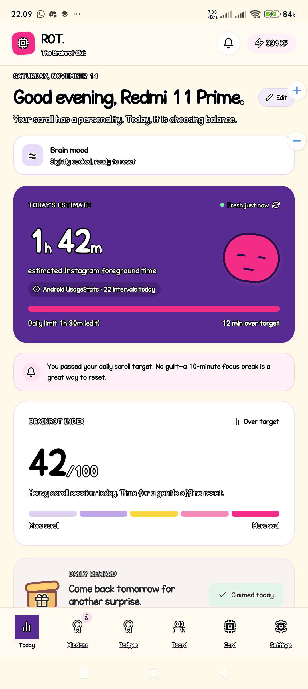
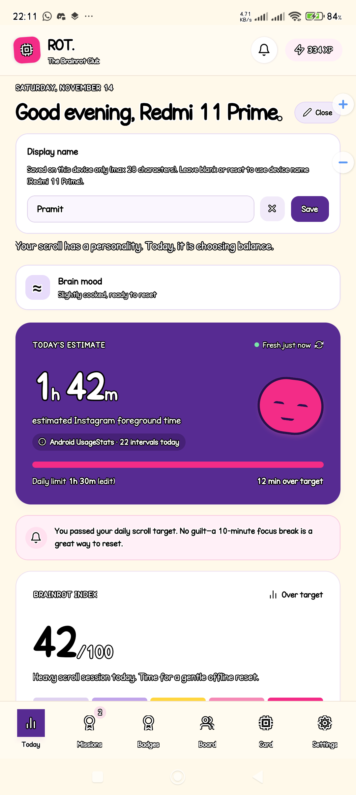
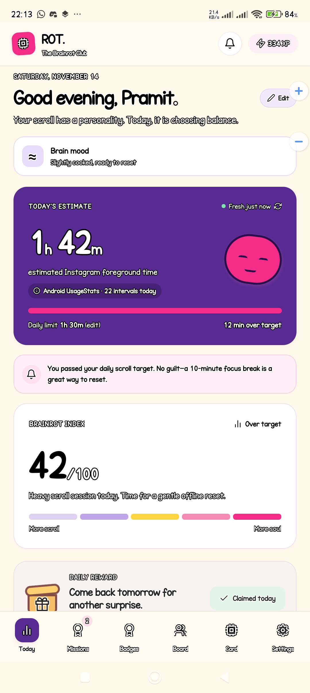
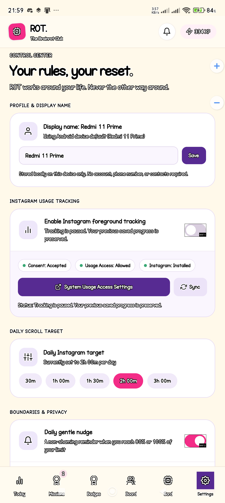
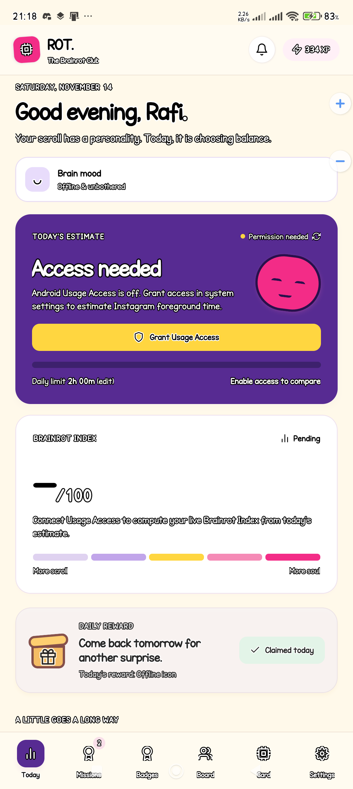
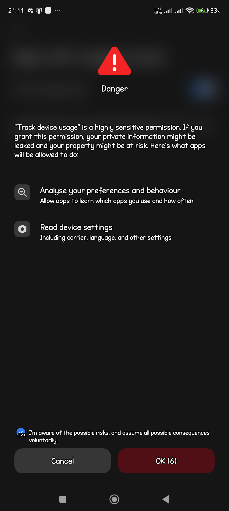
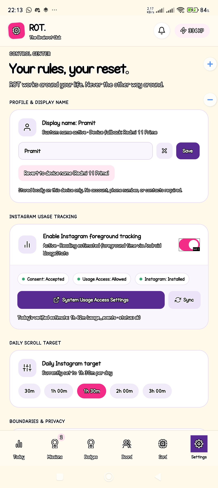
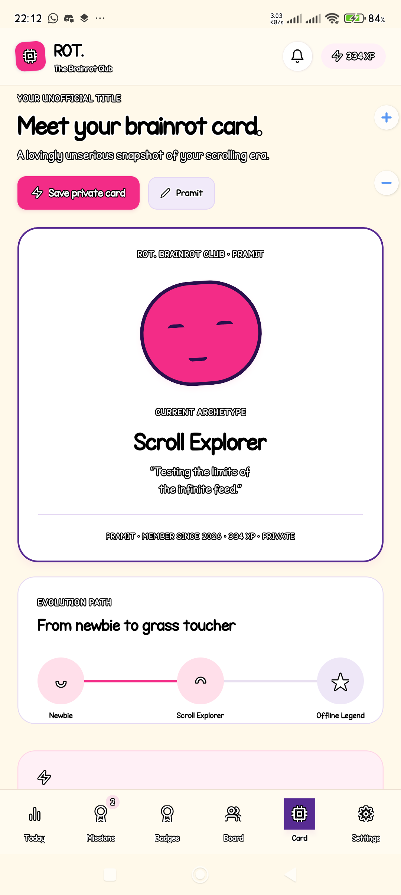
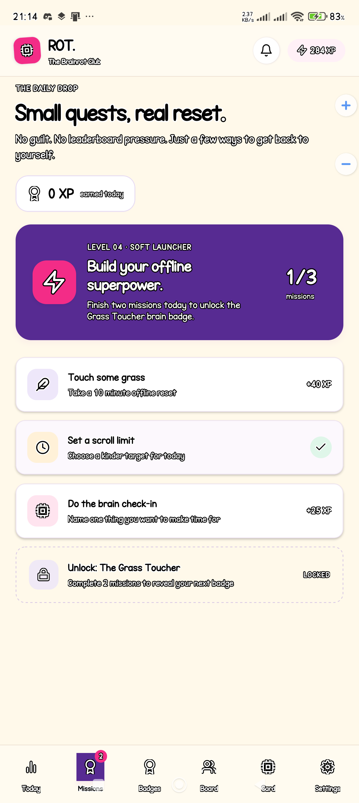

# ROT. — The Brainrot Club (Android Executive Demo)

ROT. is a local-first, privacy-respecting digital wellbeing companion that helps Gen Z users build healthier scrolling habits through playful missions, gentle boundaries, and honest Android `UsageStats` foreground estimates—without shame, dark patterns, or requiring an Instagram login.

Full technical implementation details, SRS requirements traceability (`FR-001`–`FR-031`, `NFR-01`–`NFR-18`, `BT-01`–`BT-15`, `AT-01`–`AT-12`), and the 3-PR roadmap are documented in [docs/EXECUTIVE_DEMO_REPORT.md](docs/EXECUTIVE_DEMO_REPORT.md).

---

## Executive Demo Scope (PR #1 — `feature/rot-executive-demo`)

1. **Android Development-Build Foundation:** Native Android project (`android/`) configured for **Expo `58.0.24`**, **React Native `0.88.1`**, **React `19.3.0`**, **TypeScript `6.0.3`**, and **Kotlin `2.2.10`** (`com.rot.brainrotclub`).
2. **Local-First Profile & Device Identity:** Automatically detects the best available Android device/model name (`Settings.Global.DEVICE_NAME`, `Settings.Secure` `"bluetooth_name"`, or `Build.MODEL`) on first launch, allows custom display-name editing from Today or Settings (max 28 characters, trimmed, non-blank), persists locally across cold restarts, and reverts cleanly to the device-name default (`Redmi 11 Prime`) or `"ROT User"` fallback.
3. **Instagram Foreground Tracking (`UsageStatsModule.kt`):** Queries `UsageStatsManager` (`queryEvents` with multi-activity transition tracking across `InstagramMainActivity`, `ModalActivity`, and `TransparentModalActivity`, plus deduplicated `queryUsageStats(INTERVAL_DAILY)` fallback) for `com.instagram.android`.
4. **Honest 9-State `UsageStats` Data Contract:**
   - Every query returns a structured `UsageQueryResult` (`status`, `estimatedMinutes`, `lastUpdatedAt`, `source`, `isComplete`, `errorCode`).
   - Distinguishes `permission_required`, `tracking_paused`, `not_installed`, `no_os_record`, `query_failed`, `stale`, `incomplete`, `zero_usage`, and `ok`.
   - **Never displays missing, paused, or failed data as `0h 00m`**, and preserves the last verified estimate separately (`cachedUsageSummary`) so failed or revoked queries never erase historical data.
   - Labels the metric strictly as **`estimated Instagram foreground time`** (never claiming exact Reel counts).
5. **Configurable Daily Scroll Target & Remaining Time:** Supports `30m`, `1h 00m`, `1h 30m`, `2h 00m`, and `3h 00m` targets (plus optional `+30m` Weekend Breathing Room) with non-shaming gentle nudges at 80% and 100%.
6. **Persistent Missions, Idempotent XP, Daily Chest & Badges:** Persisted locally via `AsyncStorage` (`@rot_executive_demo_state_v1`) with deterministic event keys (`mission:<date>:<id>`, `chest:<date>`, `break:<date>:<session>`) preventing duplicate XP awards.
7. **Focus Break Timer:** Supports 1-minute (demo), 5-minute, and 10-minute focus sessions, awarding `+30 XP`, completing the *"Touch some grass"* mission, and unlocking the **`Offline Icon`** badge.
8. **Privacy & Local History Reset:** One-tap local history deletion in **Settings > Local Data & History**.

---

## 1. Prerequisites

| Requirement | Verified Version |
| :--- | :--- |
| **Node.js** | v22+ or v24+ |
| **JDK** | JDK 17 (`JAVA_HOME` configured) |
| **Android SDK** | `compileSdkVersion = 37`, `targetSdkVersion = 36`, `minSdkVersion = 24`, `buildToolsVersion = 37.0.0` |
| **Android NDK / Kotlin** | NDK `27.1.12297006` / Kotlin `2.2.10` |
| **Expo / React Native** | `expo@58.0.24`, `react-native@0.88.1`, `react@19.3.0`, `typescript@6.0.3` |
| **Target Device** | Android 8.0+ physical device or emulator (verified on **Xiaomi Redmi 11 Prime**, Android 14 / API 34) |

---

## 2. Local Setup

Clone the repository, check out `feature/rot-executive-demo`, and install dependencies:

```bash
git checkout feature/rot-executive-demo
npm install
```

---

## 3. Android Debug Build

To compile the native Android debug APK (`android/app/build/outputs/apk/debug/app-debug.apk`):

```bash
# macOS / Linux
cd android && ./gradlew :app:assembleDebug --no-daemon

# Windows (PowerShell / CMD)
cd android && .\gradlew.bat :app:assembleDebug --no-daemon
```

> **Windows Long-Path Mitigation:** `android/app/build.gradle` configures a root-relative CMake staging directory (`${rootDir.toPath().root}rot-cxx`) and `-DCMAKE_OBJECT_PATH_MAX=210` so Windows builds succeed regardless of repository folder depth.

---

## 4. Physical Device Installation

1. Enable **Developer Options** and **USB Debugging** (plus **Install via USB** on Xiaomi/MIUI devices) on your Android phone.
2. Verify device connection:
   ```bash
   adb devices -l
   ```
3. Install the debug APK, forward the Metro bundler port, and launch the application:
   ```bash
   adb install -r android/app/build/outputs/apk/debug/app-debug.apk
   adb reverse tcp:8081 tcp:8081
   npx expo start --dev-client
   ```

---

## 5. Usage Access Permission Setup

1. On first launch, ROT displays the **Transparent Usage Setup** consent modal explaining what is read (`com.instagram.android` foreground activity intervals) and what is never collected (no passwords, DMs, contacts, or exact Reel counts).
2. Tap **Agree & Open Android Usage Access** (or use **Grant permission** on the Today card / **System Usage Access Settings** in Settings).
3. In Android's **Usage access** list, select **ROT.** and enable **Permit usage access**.
4. Return to **ROT.** — `AppState` automatically detects foreground resume and refreshes the `UsageStats` estimate.

For automated testing via ADB:

```bash
# Grant Usage Access via AppOps
adb shell appops set com.rot.brainrotclub GET_USAGE_STATS allow

# Revoke Usage Access to verify the "Access needed" state
adb shell appops set com.rot.brainrotclub GET_USAGE_STATS ignore
```

---

## 6. Xiaomi / MIUI Permission Notes

- On **Xiaomi MIUI / HyperOS (Android 14)**, launching `Settings.ACTION_USAGE_ACCESS_SETTINGS` with `package:com.rot.brainrotclub` opens MIUI's **`SpecialPermissionInterceptActivity`** security warning dialog with a **10-second countdown** before the **Accept** button is enabled.
- `UsageStatsModule.kt` handles package-specific deep linking with automatic fallback to the general `ACTION_USAGE_ACCESS_SETTINGS` list if an OEM ROM blocks package-targeted URIs.
- MIUI's `UsageStatsManager.queryUsageStats(INTERVAL_DAILY, ...)` can return duplicate overlapping daily buckets; `UsageStatsModule.kt` prioritizes granular `queryEvents` transitions (`ACTIVITY_RESUMED` / `ACTIVITY_PAUSED`) and deduplicates daily fallback buckets by taking the maximum bucket duration per calendar day.

---

## 7. User Display-Name Setup

- **Automatic Device Default:** On first launch, `UsageStatsModule.getDeviceProfileInfo()` queries `Settings.Global.DEVICE_NAME`, `Settings.Secure` (`"bluetooth_name"`), and `Build.MODEL` (yielding `Redmi 11 Prime` on the Xiaomi test device) and uses that as the initial display name.
- **Custom Display Name:** Tap the **Edit** chip beside the greeting on the **Today** screen or go to **Settings > Profile & Display Name** to enter a custom display name (trimmed, validated against blank input, max 28 characters).
- **Persistence & Fallback:** The custom name is persisted in `AsyncStorage` (`@rot_executive_demo_state_v1`) and updates the Today greeting, Brainrot Card, Leaderboard, and Settings immediately and across cold restarts. Tapping **Revert to device name** (or saving a blank input) restores the Android device default (`Redmi 11 Prime`), or `"ROT User"` if no device name is available.

---

## 8. Verification Commands

Run all static and unit checks from the project root:

```bash
npm run typecheck
npm run lint
npm test
```

---

## 9. Known Limitations

1. **App-Level Foreground Granularity Only:** Android `UsageStatsManager` reports package-level activity lifecycle events (`com.instagram.android`), not internal Instagram sub-views. ROT reports **estimated Instagram foreground time** and never claims exact Reel counts.
2. **OS `UsageEvents` Retention Window (~7 Days):** Android retains raw `UsageEvents` for approximately 7 days before pruning older events into coarse buckets.
3. **OEM Background / Bucket Variance:** If Android only returns coarse daily summary buckets without granular `UsageEvents`, ROT marks the result `status: 'incomplete'` (`isComplete: false`) and displays an explicit partial-data warning banner.
4. **Local-Only Prototype Scope:** Squads, friend invites, and public leaderboards remain local-only mock previews in PR #1 and require backend infrastructure in a post-MVP phase.

---

## Verified Device Screenshots (`Xiaomi Redmi 11 Prime`, Android 14)

| State | Screenshot |
| :--- | :--- |
| **Today — Device-Name Default & Verified Estimate (`1h 42m`)** |  |
| **Today — Inline Display-Name Editor (`Pramit`)** |  |
| **Today — Custom Name Persisted Across Cold Restart** |  |
| **Today — Tracking Paused (`Preserves Saved Progress`)** |  |
| **Today — Permission Required (`Never Shows 0h 00m`)** |  |
| **Xiaomi MIUI — Special Permission Intercept Flow** |  |
| **Settings — Profile & Display Name + Usage Access Diagnostics** |  |
| **Brainrot Card — Custom Identity (`ROT. BRAINROT CLUB · PRAMIT`)** |  |
| **Missions — Idempotent XP & Daily Quests** |  |
