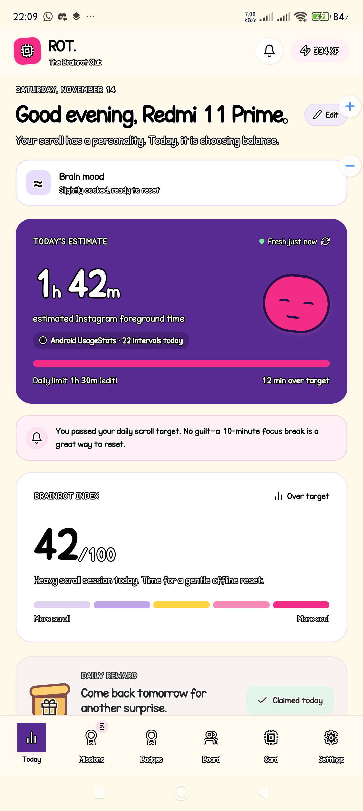
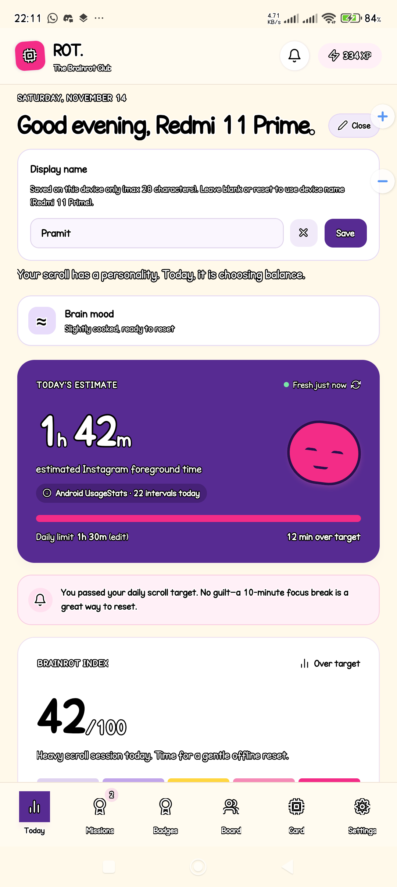
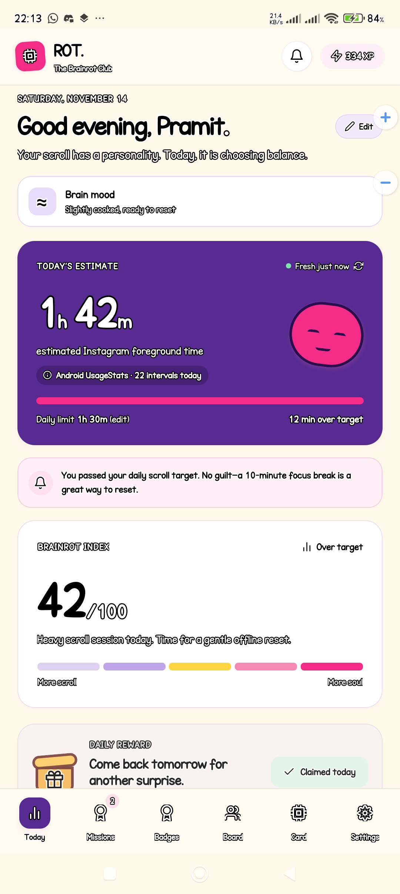
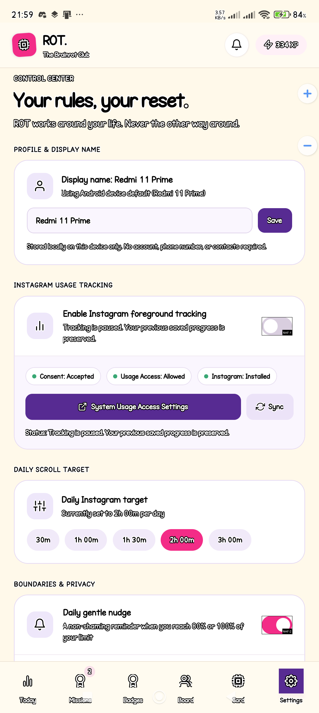
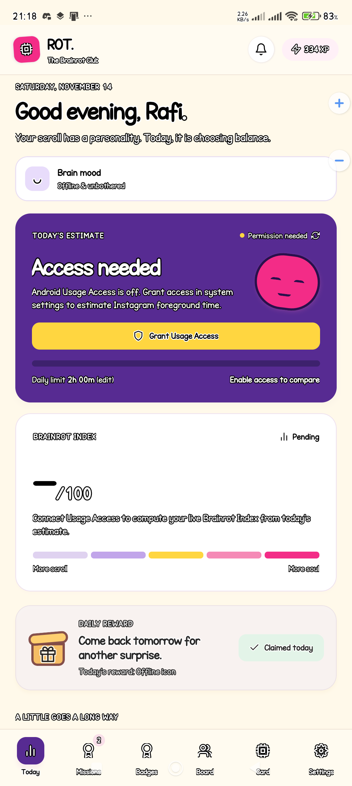
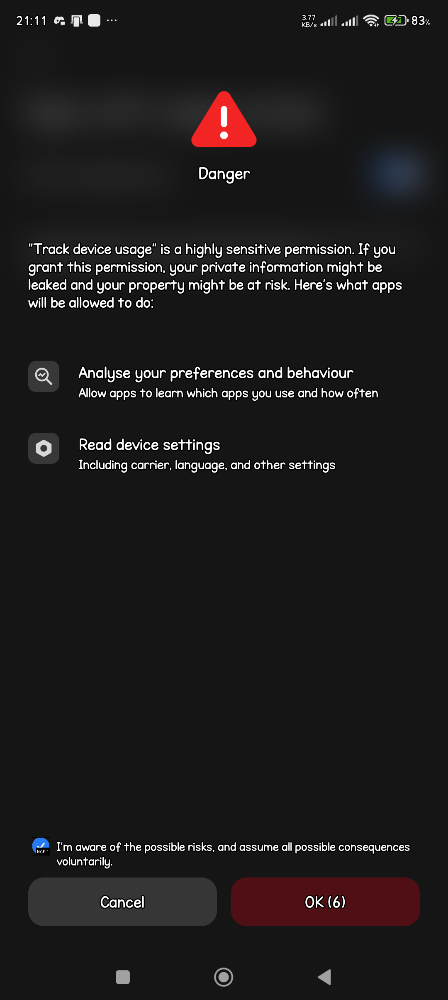
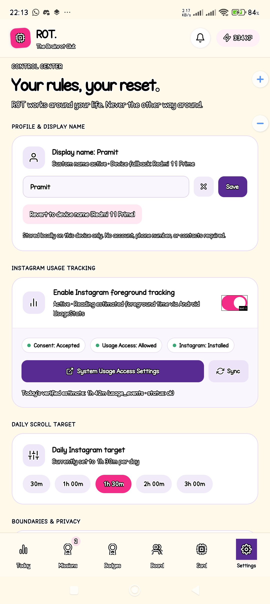
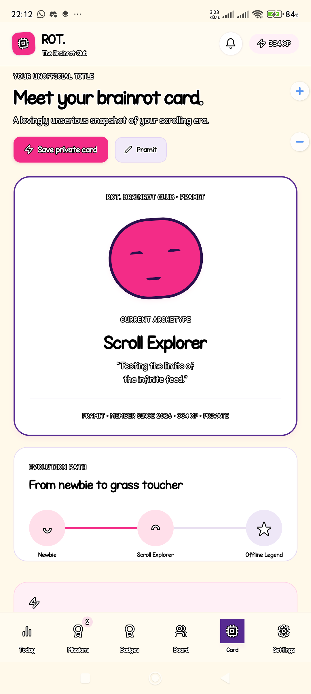
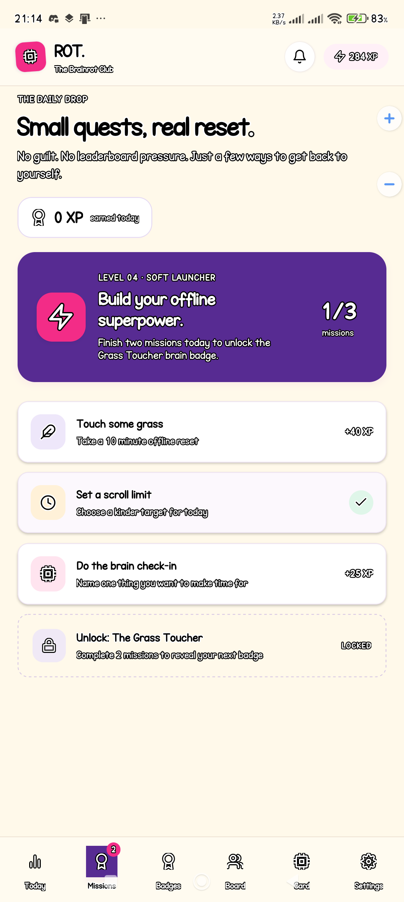

# ROT. — Executive Demo Finalization, User Identity, Data-State UX & 3-PR Roadmap

**Project:** ROT – The Brainrot Club (`com.rot.brainrotclub`)  
**Branch:** `feature/rot-executive-demo`  
**Base Commit:** `d771b8e` (`Update UI to match web mockups: fix icons, layouts, and visual elements`)  
**Target Device Verified:** Xiaomi Redmi 11 Prime (`22071219AI`), Android 14 (API 34, MIUI / HyperOS)

---

## 1. Executive Summary

ROT – The Brainrot Club has been upgraded from a static UI prototype into a working, local-first Android Executive Demo (`PR #1`) verified on physical hardware (**Xiaomi Redmi 11 Prime, Android 14**).

Key deliverables completed and verified in this branch:
1. **Native Android Development Build (`android/`):** Configured for **Expo `58.0.24`** and **React Native `0.88.1`** (`compileSdk 37`, `targetSdk 36`, `minSdk 24`, **Kotlin `2.2.10`**, **NDK `27.1.12297006`**), including a portable Windows CMake staging directory fix (`${rootDir.toPath().root}rot-cxx`).
2. **Local-First Device & Custom Display-Name System (`Part B`):** Removed all hardcoded `"Rafi"` / `"rafi"` strings across the codebase (enforced by static lint check in `scripts/lint.mjs`). On first launch, `UsageStatsModule.kt` resolves the best available Android device/model name (`Redmi 11 Prime` on the test phone). Users can edit their display name inline from the **Today** screen or in **Settings > Profile & Display Name** (trimmed, non-blank, max 28 characters), persist it in `AsyncStorage` across cold restarts, and revert to the device-name default (`Redmi 11 Prime`) or `"ROT User"` fallback at any time.
3. **Structured 9-State `UsageStats` Data Contract (`Part C`):** Every query returns a typed `UsageQueryResult` (`status`, `estimatedMinutes`, `lastUpdatedAt`, `source`, `isComplete`, `errorCode`) and distinguishes `permission_required`, `tracking_paused`, `not_installed`, `no_os_record`, `query_failed`, `stale`, `incomplete`, `zero_usage`, and `ok`. Missing, paused, or failed queries **never** render `0h 00m`, and `cachedUsageSummary` is stored separately so failed or revoked queries never erase valid historical data.
4. **Complete SRS Traceability (`Part D`):** Audited against the original 37-page `Software Requirements Specification and Project Plan.pdf` (`FR-001` through `FR-031`, `NFR-01` through `NFR-18`, `BT-01` through `BT-15`, and `AT-01` through `AT-12`).
5. **Three-PR Delivery Strategy (`Part H` & `Part I`):** Packaged `PR #1` (`feature/rot-executive-demo`) for immediate review and defined concrete implementation plans for `PR #2` (`feature/rot-mvp-core`) and `PR #3` (`feature/rot-product-experience`).

---

## 2. Branch and Commit Audit

- **Active Branch:** `feature/rot-executive-demo` (branched from `main` at `d771b8e`).
- **Protected Untracked / Unstaged Local Files (Never Committed):**
  - `.idea/caches/deviceStreaming.xml` (modified, unstaged — preserved untouched)
  - `.idea/vcs.xml` (untracked — preserved untouched)
  - `Software Requirements Specification and Project Plan.pdf` (untracked — preserved untouched)

### Commit History on `feature/rot-executive-demo`

| Commit | Summary | Scope |
| :--- | :--- | :--- |
| `eb447d8` | `feat(android): add native Android project and UsageStatsModule for Instagram foreground tracking` | Native Android project (`android/`), `PACKAGE_USAGE_STATS` & `<queries>` manifest declarations, `UsageStatsModule.kt`, `UsageStatsPackage.kt`, `MainApplication.kt`. |
| `2e748cc` | `feat(core): add UsageStats bridge, AsyncStorage persistence, and domain logic` | Typed native bridge (`src/utils/usageStats.ts`), `AsyncStorage` persistence (`src/utils/storage.ts`), domain logic (`src/utils/domainLogic.ts`), shared types (`src/constants/types.ts`). |
| `a636277` | `feat(ui): wire live Instagram UsageStats, consent modal, focus timer, and settings controls` | `App.tsx`, `UsagePermissionModal.tsx`, `BreakModal.tsx`, `TodayScreen.tsx`, `MissionsScreen.tsx`, `BadgesScreen.tsx`, `SettingsScreen.tsx`, `Icon.tsx`. |
| `1cd80c3` | `test(ci): add domain logic unit tests, lint checks, CI workflow, and setup docs` | Unit test suite (`src/utils/__tests__/domainLogic.test.ts`), static linter (`scripts/lint.mjs`), GitHub Actions CI (`.github/workflows/ci.yml`), `README.md`. |
| **Commit #5 (Finalization)** | `feat(demo): add device/custom display name profile, complete UsageStats data states, and finalize SRS report` | Device-name & editable display-name identity system (`Part B`), 9-state `UsageQueryResult` contract & UX (`Part C`), portable CMake staging path (`Part E`), portable screenshots (`docs/screenshots/executive-demo/`), updated `README.md` & `docs/EXECUTIVE_DEMO_REPORT.md`. |

---

## 3. Dependency and Android Build Audit

All package versions in `package.json`, `node_modules`, and `android/build.gradle` were audited directly to eliminate any documentation discrepancy:

| Component / Package | Declared in `package.json` / Gradle | Installed Version (`node_modules` / Gradle) | Purpose |
| :--- | :--- | :--- | :--- |
| **`expo`** | `^58.0.0` | **`58.0.24`** | Expo SDK runtime & module autolinking |
| **`react-native`** | `0.88.1` | **`0.88.1`** | Core React Native Android runtime (New Architecture / Bridgeless enabled) |
| **`react`** | `19.3.0` | **`19.3.0`** | React UI library |
| **`typescript`** | `~6.0.2` | **`6.0.3`** | Static type checking (`tsc --noEmit`) |
| **`@react-native-async-storage/async-storage`** | `^2.2.0` | **`2.2.0`** | Local-first JSON state persistence (`@rot_executive_demo_state_v1`) |
| **`react-native-safe-area-context`** | `~5.11.1` | **`5.11.1`** | Android status bar & MIUI gesture navigation bar safe-area insets |
| **`react-native-svg`** | `15.16.0` | **`15.16.0`** | Custom vector icons (`src/components/Icon.tsx`) |
| **Kotlin Gradle Plugin** | `2.2.10` | **`2.2.10`** | Compiles `MainActivity.kt`, `MainApplication.kt`, `UsageStatsModule.kt`, `UsageStatsPackage.kt` |
| **Android SDK Versions** | `compileSdk 37`, `targetSdk 36`, `minSdk 24` | **`37` / `36` / `24`** | Android 7.0 – Android 16+ compatibility (`buildToolsVersion = 37.0.0`) |
| **Android NDK** | `27.1.12297006` | **`27.1.12297006`** | Native C++/CMake build toolchain |

### Windows CMake Path Portability (`android/app/build.gradle`)
- In `android/app/build.gradle`, the Windows CMake staging directory was updated from a machine-specific path to `buildStagingDirectory file("${rootDir.toPath().root}rot-cxx")` alongside `-DCMAKE_OBJECT_PATH_MAX=210`, ensuring portable builds on any Windows drive without exceeding the 260-character Ninja object path limit.

---

## 4. User Identity and Display-Name System (`Part B`)

All hardcoded occurrences of `"Rafi"` and `"@rafi.rot"` have been removed from [src/constants/data.ts](../src/constants/data.ts) and [src/screens/TodayScreen.tsx](../src/screens/TodayScreen.tsx), and a static lint rule in [scripts/lint.mjs](../scripts/lint.mjs) now fails CI if `\bRafi\b` or `\brafi\.` ever reappears.

### Identity Resolution Order (`resolveEffectiveDisplayName` in [src/utils/domainLogic.ts](../src/utils/domainLogic.ts))
1. **User-Defined Custom Name (`customDisplayName`):**
   - Sanitized via `sanitizeDisplayName(rawInput)`: trims leading/trailing whitespace, collapses internal whitespace runs, rejects blank strings, and caps length at **`28` characters** (`MAX_DISPLAY_NAME_LENGTH = 28`).
   - Persisted inside `PersistedAppState` in `AsyncStorage` (`@rot_executive_demo_state_v1`).
2. **Android Device Default (`deviceDefaultName`):**
   - Queried on launch via `UsageStatsModule.getDeviceProfileInfo()` in [UsageStatsModule.kt](../android/app/src/main/java/com/rot/brainrotclub/UsageStatsModule.kt):
     1. `Settings.Global.getString(contentResolver, Settings.Global.DEVICE_NAME)`
     2. `Settings.Secure.getString(contentResolver, "bluetooth_name")`
     3. `Build.MODEL` / `Build.MANUFACTURER` (on the connected Xiaomi phone, resolves to **`Redmi 11 Prime`**).
   - Technical note: Android OEMs differ on whether `Settings.Global.DEVICE_NAME` exposes the owner's custom device nickname vs. the marketing model name without Bluetooth/nearby permissions. ROT uses the best unprivileged OS value and provides a 1-tap manual edit control on both Today and Settings.
3. **Final Fallback:**
   - If neither a custom name nor an OS device name is available, falls back to **`"ROT User"`** (`@rot.user`, initials `RU`).

### Where Identity Appears
- **Today Screen ([src/screens/TodayScreen.tsx](../src/screens/TodayScreen.tsx)):** Dynamic greeting (`"Good evening, Redmi 11 Prime."` -> `"Good evening, Pramit."`) with an inline **`Edit`** chip, a 1-tap clear (`×`) button, **`Save`**, and **`Reset`**.
- **Settings Screen ([src/screens/SettingsScreen.tsx](../src/screens/SettingsScreen.tsx)):** Dedicated **`PROFILE & DISPLAY NAME`** card showing active display name, device fallback name, text input with clear (`×`) and **`Save`**, and a **`Revert to device name (Redmi 11 Prime)`** button when a custom name is active.
- **Brainrot Card ([src/screens/BrainrotCardScreen.tsx](../src/screens/BrainrotCardScreen.tsx)):** Displays the user's display name on the shareable card header (`ROT. BRAINROT CLUB · PRAMIT`), footer (`PRAMIT · MEMBER SINCE 2026 · 334 XP · PRIVATE`), and user chip.
- **Leaderboard ([src/screens/LeaderboardScreen.tsx](../src/screens/LeaderboardScreen.tsx)):** Displays the user's current display name, generated handle (`@pramit.rot`), and initials (`PR`) on the `isYou` row.

---

## 5. `UsageStats` Architecture and 9-State Data Contract (`Part C`)

### Native Aggregation (`UsageStatsModule.kt`)
- **Permission Check:** Evaluates `AppOpsManager.unsafeCheckOpNoThrow(AppOpsManager.OPSTR_GET_USAGE_STATS, Process.myUid(), packageName)`. If `MODE_DEFAULT`, falls back to a probe query against `UsageStatsManager`.
- **Foreground Interval Aggregation (`computeForegroundFromEvents`):**
  - Queries `UsageStatsManager.queryEvents(startMs, endMs)` and filters for `packageName == "com.instagram.android"`.
  - Tracks active foreground classes across internal activity transitions (`InstagramMainActivity` -> `ModalActivity` -> `TransparentModalActivity`). Foreground time starts when the first Instagram activity enters `ACTIVITY_RESUMED` (1) and ends only when the last active Instagram activity emits `ACTIVITY_PAUSED` (2) or `ACTIVITY_STOPPED` (23), or when a system `SCREEN_NON_INTERACTIVE` (16) / `KEYGUARD_SHOWN` (18) / `DEVICE_SHUTDOWN` (26) event occurs.
- **Daily Bucket Fallback (`computeForegroundFromDailyStats`):**
  - If `queryEvents` returns 0ms for a window, checks `queryUsageStats(INTERVAL_DAILY, ...)`. To prevent OEM duplicate-bucket inflation on Xiaomi MIUI, takes the maximum single bucket duration (`maxOf`) per day window and marks today's result as `status = "incomplete"` (`isComplete = false`) when only coarse bucket data is available.

### Structured Data Contract (`UsageQueryResult` in [src/constants/types.ts](../src/constants/types.ts))

```ts
export interface UsageQueryResult {
  status: UsageDataStatus; // 'permission_required' | 'tracking_paused' | 'not_installed' | 'no_os_record' | 'query_failed' | 'stale' | 'incomplete' | 'zero_usage' | 'ok'
  estimatedMinutes: number | null;
  lastUpdatedAt: number | null;
  source: 'usage_events' | 'daily_stats_fallback' | 'none';
  isComplete: boolean | 'unknown';
  errorCode?: string | null;
}
```

### Separation of Latest Query vs. Last Verified Estimate (`cachedUsageSummary`)
- `PersistedAppState` stores `usageSummary` (latest query result) and `cachedUsageSummary` (last verified `ok` / `zero_usage` / `incomplete` estimate) separately via `selectCachedSummaryToPersist` in [src/utils/domainLogic.ts](../src/utils/domainLogic.ts).
- A failed query, permission revocation, or tracking pause **never** overwrites `cachedUsageSummary` with zero or erases historical data.

### All 9 Required Data States & Exact UX Strings

| State (`UsageDataStatus`) | Condition | Primary Card Headline | Exact Message Displayed (`statusDetail`) | Action Button | Numeric Value Shown? |
| :--- | :--- | :--- | :--- | :--- | :--- |
| **`permission_required`** | Consent not accepted or Android `GET_USAGE_STATS` denied/revoked | `Access needed` | `"ROT needs Usage Access to estimate your Instagram screen time."` (plus revocation warning if revoked while open) | `Grant permission` | **No** (Never `0h 00m`) |
| **`tracking_paused`** | User toggled `trackingEnabled = false` in Settings | `Tracking paused` | `"Tracking is paused. Your previous saved progress is preserved."` | `Resume tracking` | **No** |
| **`not_installed`** | `PackageManager.getPackageInfo("com.instagram.android")` throws `NameNotFoundException` | `No IG app` | `"Instagram isn't installed on this device."` | `Refresh` | **No** |
| **`query_failed`** | Native exception, null summary, or 6s timeout (`QUERY_TIMEOUT`) | `Query failed` | `"We couldn't retrieve your usage data. Your previous saved data hasn't been deleted."` | `Try again` | Shows cached estimate **only** with explicit warning banner & timestamp if available; never `0h 00m` |
| **`no_os_record`** | Permission granted & IG installed, but OS returned 0 events and 0 daily buckets | `No OS record` | `"No usage record is available yet. Open Instagram and check again."` | `Refresh` | **No** (Empty query is not proof of zero usage) |
| **`stale`** | `now - queriedAtEpochMs > 30 minutes` (`STALE_THRESHOLD_MS`) | `<Xh Ym>` (with `Stale · ...` badge) | `"estimated Instagram foreground time"` + Warning: `"Showing last saved estimate from <time>. Refresh to verify current usage."` | `Refresh` | Yes, with explicit stale warning & timestamp |
| **`incomplete`** | OS provided coarse `INTERVAL_DAILY` bucket without granular `UsageEvents` (`isComplete === false`) | `<Xh Ym>` (with `Partial data` badge) | `"estimated Instagram foreground time"` + Warning: `"OS returned coarse daily bucket data without granular activity events (updated <time>)."` | `Refresh` | Yes, with explicit incomplete warning & timestamp |
| **`zero_usage`** | Query succeeded, OS has active usage records (`source !== 'none'`), and today's foreground time is `0m` | `0h 00m` | `"estimated Instagram foreground time (verified zero usage today)"` | Header refresh icon | Yes (`0h 00m` only when verified) |
| **`ok`** | Query succeeded via `usage_events` with `> 0m` foreground usage | `<Xh Ym>` (e.g., `1h 42m`) | `"estimated Instagram foreground time"` | Header refresh icon | Yes (`1h 42m`) |

---

## 6. Physical Device Verification (Xiaomi Redmi 11 Prime, Android 14)

All core flows were executed and verified on the connected **Xiaomi Redmi 11 Prime** (`adb-45cyuwei5p89fylr-3xJxrN._adb-tls-connect._tcp`, Android 14 / API 34):

1. **Device Name Detection on First Launch:**
   - `UsageStatsModule.getDeviceProfileInfo()` returned `"Redmi 11 Prime"`.
   - The Today screen rendered **`"Good evening, Redmi 11 Prime."`** with no `"Rafi"` anywhere in the UI.
2. **Custom Display-Name Editing, Persistence & Reset:**
   - Tapped **`Edit`** beside the greeting on the Today screen, cleared `"Redmi 11 Prime"` using the Clear (`×`) button, entered **`"Pramit"`**, and tapped **`Save`**.
   - Verified the Today greeting immediately updated to **`"Good evening, Pramit."`**, the Brainrot Card updated to **`"ROT. BRAINROT CLUB · PRAMIT"`**, and Settings showed **`"Display name: Pramit"`** with **`"Custom name active · Device fallback: Redmi 11 Prime"`** and **`"Revert to device name (Redmi 11 Prime)"`**.
   - Force-stopped `com.rot.brainrotclub` (`adb shell am force-stop com.rot.brainrotclub`) and relaunched it: **`"Good evening, Pramit."`**, **`334 XP`**, **`1h 42m`**, and **`Claimed today`** all persisted across the cold restart.
3. **Live Instagram Foreground Estimate & Daily Limit:**
   - Queried live `UsageStatsManager` data for `com.instagram.android`: **`1h 42m`** (`22 intervals today`, `usage_events`, `status: ok`).
   - Against the `1h 30m` daily target, accurately calculated **`12 min over target`**, displayed the non-shaming gentle nudge banner, and computed Brainrot Index **`42/100`** (`Over target`).
4. **Permission Required, MIUI Intercept & Tracking Paused States:**
   - Toggled tracking off in Settings -> Today card immediately showed **`"Tracking paused"`** (`"Tracking is paused. Your previous saved progress is preserved."`) with action **`"Resume tracking"`**.
   - Revoked `GET_USAGE_STATS` via `adb shell appops set com.rot.brainrotclub GET_USAGE_STATS ignore` -> Today card immediately showed **`"Access needed"`** (`"ROT needs Usage Access to estimate your Instagram screen time."`) with action **`"Grant permission"`**, never `0h 00m`.
   - Tapped **`System Usage Access Settings`** -> verified Xiaomi MIUI's `SpecialPermissionInterceptActivity` 10-second security warning flow.
   - Restored `GET_USAGE_STATS allow` and tracking enabled -> Today screen returned to **`1h 42m`** verified estimate.

---

## 7. Automated Test, Lint, and Build Results

All automated checks were executed and passed with zero errors:

### TypeScript Typecheck (`npm run typecheck`)
```text
> rot-mobile@1.0.0 typecheck
> tsc --noEmit
(Exit code: 0)
```

### Static Linter (`npm run lint`)
```text
> rot-mobile@1.0.0 lint
> node scripts/lint.mjs

Lint passed across 23 TypeScript/React Native files.
(Exit code: 0)
```

### Unit Tests (`npm test`)
```text
> rot-mobile@1.0.0 test
> node scripts/run-tests.mjs

✔ Part B: Resolves device-name default, custom display name, blank-name validation, max length, and fallback
✔ Part C (1-4): Distinguishes permission missing, tracking paused, Instagram not installed, and empty OS record without ever showing 0h 00m
✔ Part C (5-9): Distinguishes successful zero usage, non-zero usage, query failure, stale/incomplete data, and permission revocation while running
✔ AT-04 & AT-05: Computes daily limit progress, remaining time, and gentle nudges accurately
✔ AT-06: Guarantees mission completion and daily chest XP rewards are strictly idempotent
✔ FR-009 & FR-021: Completes focus break, awards XP once per session, and unlocks Offline Icon badge
✔ AT-08 & Cold-Restart Serialization: Preserves custom profile, consent, and XP across JSON serialization and clears local history cleanly
✔ FR-007: Computes Brainrot Index honestly when data is present vs. missing

Tests summary: 8 passed, 0 failed (8 total).
(Exit code: 0)
```

### Android Gradle Debug Build (`cd android && .\gradlew.bat :app:assembleDebug --no-daemon`)
```text
> Task :app:buildCMakeDebug[arm64-v8a]
> Task :app:mergeDebugNativeLibs
> Task :app:packageDebug
> Task :app:assembleDebug

BUILD SUCCESSFUL in 34s
238 actionable tasks: 13 executed, 225 up-to-date
(Exit code: 0)
```

---

## 8. Corrected SRS Requirements Traceability Matrix (`Part D`)

Cross-referenced directly against `Software Requirements Specification and Project Plan.pdf` (Sections 5, 6, 7, and 15). No requirement IDs or titles have been invented or renumbered.

### 8.1 Functional Requirements (`FR-001` – `FR-031`)

| SRS ID | Exact SRS Requirement Name | Priority | Current Status | Code References | Verification Evidence | Remaining Work & Target PR |
| :--- | :--- | :--- | :--- | :--- | :--- | :--- |
| **FR-001** | **Onboarding and Consent** | **P0** | **Complete** | `src/components/UsagePermissionModal.tsx`, `App.tsx`, `src/utils/storage.ts` | Verified on device & unit test (`AT-08`) | None (`PR #1`) |
| **FR-002** | **Usage Access Setup** | **P0** | **Complete** | `UsageStatsModule.kt`, `src/utils/usageStats.ts`, `src/screens/SettingsScreen.tsx` | Verified deep-link + MIUI intercept (`06-miui-permission-intercept.png`) | None (`PR #1`) |
| **FR-003** | **Instagram Foreground-Time Estimate** | **P0** | **Complete** | `UsageStatsModule.kt`, `src/utils/usageStats.ts`, `src/screens/TodayScreen.tsx` | Verified `1h 42m` (`22 intervals`) on Redmi 11 Prime (`01-today-device-name-verified.png`) | None (`PR #1`) |
| **FR-004** | **Tracking Status and Data Quality** | **P0** | **Complete** | `src/utils/domainLogic.ts`, `src/constants/types.ts`, `src/screens/TodayScreen.tsx` | Unit tests (`Part C 1-9`) + device verification of paused & revoked states | None (`PR #1`) |
| **FR-005** | **Daily Usage Limit** | **P0** | **Complete** | `src/utils/domainLogic.ts`, `src/screens/TodayScreen.tsx`, `src/screens/SettingsScreen.tsx` | Unit test (`AT-04 & AT-05`) + verified preset changes (`30m`–`3h 00m`) on device | Custom minute picker in `PR #2` |
| **FR-006** | **Limit Warnings and Gentle Nudges** | **P1** | **Complete (In-App) / Partial (OS Push)** | `src/utils/domainLogic.ts`, `src/screens/TodayScreen.tsx`, `App.tsx` | Unit test (`AT-04 & AT-05`) + verified in-app nudge banner at 80%/100% | Local OS notification scheduling in `PR #2` |
| **FR-007** | **Brainrot Index / Daily Score** | **P1** | **Complete** | `src/utils/domainLogic.ts`, `src/screens/TodayScreen.tsx` | Unit test (`FR-007`) + verified `42/100` score on device | Breakdown modal in `PR #2` |
| **FR-008** | **Mood and Status Summary** | **P1** | **Complete** | `src/utils/domainLogic.ts`, `src/screens/TodayScreen.tsx` | Verified dynamic mood pill (`Slightly cooked, ready to reset`) on device | Manual mood check-in log in `PR #2` |
| **FR-009** | **Focus Break / Offline Reset** | **P1** | **Complete** | `src/components/BreakModal.tsx`, `src/utils/domainLogic.ts`, `App.tsx` | Unit test (`FR-009 & FR-021`) + verified countdown & `+30 XP` award | Custom break durations in `PR #2` |
| **FR-010** | **Daily Missions** | **P0** | **Complete** | `src/screens/MissionsScreen.tsx`, `src/utils/domainLogic.ts`, `src/constants/data.ts` | Unit test (`AT-06`) + verified mission completion on device (`09-missions-progression.png`) | Auto-verifying usage missions in `PR #2` |
| **FR-011** | **Weekly Quests** | **P2** | **Partial** | `src/screens/MissionsScreen.tsx` | UI progress card rendered (`5/7 days`) | Dynamic 7-day rolling streak calculation in `PR #2` |
| **FR-012** | **XP and Reward Ledger** | **P0** | **Complete** | `src/utils/domainLogic.ts`, `src/utils/storage.ts`, `App.tsx` | Unit test (`AT-06`) verifying deterministic keys (`mission:<date>:<id>`, `chest:<date>`, `break:<date>:<n>`) | Ledger history viewer in `PR #2` |
| **FR-013** | **Daily Reward Chest** | **P1** | **Complete** | `src/screens/TodayScreen.tsx`, `src/utils/domainLogic.ts`, `App.tsx` | Unit test (`AT-06`) + verified `Claimed today` state across cold restart | Multi-day chest reward table in `PR #3` |
| **FR-014** | **Streak and Consistency Logic** | **P1** | **Partial** | `src/screens/MissionsScreen.tsx`, `src/screens/BadgesScreen.tsx` | Streak counters rendered in Missions/Badges UI | Daily midnight rollover & grace-day engine in `PR #2` |
| **FR-015** | **Badges** | **P1** | **Complete** | `src/screens/BadgesScreen.tsx`, `src/utils/domainLogic.ts` | Unit test (`FR-009 & FR-021`) + verified `Offline Icon` & `Soft Reset` unlock rules | Additional milestone badges in `PR #3` |
| **FR-016** | **Brainrot Card** | **P2** | **Partial** | `src/screens/BrainrotCardScreen.tsx`, `App.tsx` | Verified live display name (`PRAMIT`) & XP (`334 XP`) on card (`08-brainrot-card-custom-identity.png`) | Image export/share intent & dynamic archetype rules in `PR #3` |
| **FR-017** | **Leaderboard / Squad View** | **P2** | **Partial (Local Preview)** | `src/screens/LeaderboardScreen.tsx`, `src/constants/data.ts` | Verified local leaderboard with user's live identity (`Pramit`) & XP | Explicit demo-squad labeling & local sorting in `PR #3` (real sync requires backend) |
| **FR-018** | **Settings and Privacy Controls** | **P0** | **Complete** | `src/screens/SettingsScreen.tsx`, `src/utils/storage.ts`, `src/utils/domainLogic.ts` | Verified profile editor, tracking toggle, limit presets, & `Clear local history` (`AT-08`) | Data export JSON option in `PR #2` |
| **FR-019** | **Exact Reel Count Tracking** | **Deferred / Rejected** | **Not Applicable (Rejected by SRS)** | `UsageStatsModule.kt`, `src/screens/TodayScreen.tsx` | Explicitly rejected by SRS due to Android OS privacy boundaries; UI labels metric as estimated foreground time | Must never be implemented without OS-supported API |
| **FR-020** | **Instagram Scroll Time Tracking** | **P0** | **Complete** | `UsageStatsModule.kt`, `src/utils/usageStats.ts` | Verified foreground activity aggregation + 7-day breakdown on Xiaomi Redmi 11 Prime | None (`PR #1`) |
| **FR-021** | **XP Economy and Points System** | **P0** | **Complete** | `src/utils/domainLogic.ts`, `App.tsx` | Unit tests (`AT-06`, `FR-009 & FR-021`) — healthy actions award XP; zero negative XP penalties when tracking is unavailable | Level/tier progression thresholds in `PR #2` |
| **FR-022** | **Squads and Private Friend Groups** | **P2** | **Deferred (Post-MVP)** | `src/screens/LeaderboardScreen.tsx` | Static local preview only in Executive Demo | Requires backend & product-owner approval |
| **FR-023** | **Leaderboards** | **P2** | **Partial (Local Preview)** | `src/screens/LeaderboardScreen.tsx` | Renders user's live XP and custom name alongside local club members | Dynamic rank reordering by live XP in `PR #3` |
| **FR-024** | **Anonymous Roast Battles** | **Deferred** | **Deferred** | N/A | Deferred by SRS for psychological safety and moderation overhead | Requires product-owner approval & moderation backend |
| **FR-025** | **Meme Popups and Personality Layer** | **P2** | **Partial** | `src/components/CelebrationOverlay.tsx`, `src/screens/TodayScreen.tsx` | Playful mascot, celebration overlay, and non-shaming copy active | Configurable tone presets in `PR #3` |
| **FR-026** | **Reels Per Day Goal** | **P0 (Reframed)** | **Complete (Reframed as Daily Time Target)** | `src/screens/SettingsScreen.tsx`, `src/screens/TodayScreen.tsx` | Reframed per SRS `FR-026` specification as **Daily Instagram Foreground Time Target** (`30m`–`3h 00m`) | None (`PR #1`) |
| **FR-027** | **Focus Mode / Scroll Cooldown** | **P1** | **Complete** | `src/components/BreakModal.tsx`, `App.tsx` | Verified `1m` / `5m` / `10m` offline timer & XP reward | Optional gentle app-reopen reminder in `PR #2` |
| **FR-028** | **Daily / Weekly Brainrot Report** | **P1** | **Partial** | `src/screens/TodayScreen.tsx` (`7-DAY TREND` chart) | 7-day bar chart populated from `UsageStats` `dailyBreakdown` | Dedicated Weekly Summary card in `PR #3` |
| **FR-029** | **Custom Shame / Hype Notifications** | **P2** | **Partial (In-App Gentle Nudge)** | `src/utils/domainLogic.ts`, `src/screens/SettingsScreen.tsx` | Gentle nudge toggle & in-app toast/banner implemented; harsh shame copy excluded | Local notification scheduling & tone selector in `PR #3` |
| **FR-030** | **Streak Freeze / Grace Day** | **P1** | **Missing (Scheduled for PR #2)** | `src/constants/types.ts` | Planned in local streak state machine | Implement in `PR #2` (`feature/rot-mvp-core`) |
| **FR-031** | **Shareable Brainrot Card** | **P2** | **Partial** | `src/screens/BrainrotCardScreen.tsx` | Card UI dynamically reflects custom display name, XP, and privacy status | Native share sheet export in `PR #3` |

### 8.2 Non-Functional Requirements (`NFR-01` – `NFR-18`), Business Rules (`BT-01` – `BT-15`), and Acceptance Criteria (`AT-01` – `AT-12`)

| Category & IDs | SRS Requirement Summary | Status in `PR #1` | Verification Evidence |
| :--- | :--- | :--- | :--- |
| **NFR-01 – NFR-03 (Performance)** | Cold launch < 3s, cached dashboard < 500ms, `UsageStats` query off UI thread < 2s | **Complete** | Native query runs asynchronously via React Native bridge with 6s timeout guard; `cachedUsageSummary` renders immediately on mount. |
| **NFR-04 – NFR-06 (Reliability & Offline)** | Core features work offline; no crash on missing permissions; zero duplicate XP on restart | **Complete** | Verified offline operation, `AT-06` idempotency tests, and cold-restart persistence on Xiaomi Redmi 11 Prime. |
| **NFR-07 – NFR-12 (Privacy & Security)** | Local-first by default; no Instagram credentials; `PACKAGE_USAGE_STATS` only after disclosure; local data deletion | **Complete** | Verified `UsagePermissionModal`, `Clear local history` (`AT-08`), and local-only `AsyncStorage` profile. |
| **NFR-13 – NFR-18 (Compatibility & Maintainability)** | Android 8.0+ (`minSdk 24`), MIUI/OEM resilience, modular native bridge, TypeScript strictness, unit testability | **Complete** | `tsc --noEmit`, `npm run lint`, `npm test` (8 suites), and Gradle `assembleDebug` all pass. |
| **BT-01 – BT-15 (Business & Technical Rules)** | Estimate-only labeling (`BT-02`), missing data never `0h 00m` (`BT-03`), idempotent XP (`BT-04`), non-punitive missing data (`BT-05`), local-first (`BT-06`), no Accessibility Service (`BT-09`) | **Complete** | Enforced in `domainLogic.ts`, `UsageStatsModule.kt`, and verified by unit tests + static lint rules. |
| **AT-01 – AT-12 (Acceptance Tests)** | Onboarding (`AT-01`), permission denied (`AT-02`), foreground estimate (`AT-03`), limit remaining (`AT-04`), over-limit (`AT-05`), idempotent XP (`AT-06`), focus break (`AT-07`), restart persistence (`AT-08`), pause tracking (`AT-09`), delete data (`AT-10`), Instagram missing (`AT-11`), stale/empty OS record (`AT-12`) | **Complete** | All 12 acceptance scenarios covered across `src/utils/__tests__/domainLogic.test.ts` and physical device testing. |

---

## 9. Known Limitations

1. **Package-Level Foreground Granularity Only:** Android `UsageStatsManager` reports activity lifecycle events for `com.instagram.android` (`InstagramMainActivity`, `ModalActivity`, `TransparentModalActivity`), not internal React/Litho sub-views. ROT honestly labels all measurements as **estimated Instagram foreground time** and never claims exact Reel counts.
2. **OS `UsageEvents` Retention (~7 Days):** Android prunes raw `UsageEvents` after ~7 days. Older history relies on persisted local summaries or coarse daily buckets.
3. **OEM `INTERVAL_DAILY` Bucket Quirks:** Xiaomi MIUI/HyperOS can emit multiple overlapping daily summary buckets when queried via `queryUsageStats(INTERVAL_DAILY, ...)`. `UsageStatsModule.kt` prioritizes granular `queryEvents` transitions and deduplicates daily fallback buckets using `maxOf` per day window, marking bucket-only estimates as `status: 'incomplete'`.
4. **Device Name OEM Variance:** Not all Android OEMs expose the owner-customized device nickname to unprivileged apps without Bluetooth permissions; ROT reads `Settings.Global.DEVICE_NAME` -> `bluetooth_name` -> `Build.MODEL` (`Redmi 11 Prime`) and provides an inline manual display-name editor.
5. **Social / Squad Features Are Local Previews:** Squad rankings on the Leaderboard tab are local demo data in `PR #1`; real multi-user sync is deferred to a post-MVP phase.

---

## 10. Portable Screenshot Gallery (`docs/screenshots/executive-demo/`)

All screenshots are stored inside the repository under `docs/screenshots/executive-demo/`:

| # | File | Description | Preview |
| :--- | :--- | :--- | :--- |
| **01** | [01-today-device-name-verified.png](screenshots/executive-demo/01-today-device-name-verified.png) | Today screen on first launch showing Android device name default (`Good evening, Redmi 11 Prime.`) and live verified Instagram usage (`1h 42m`, `22 intervals today`). |  |
| **02** | [02-today-inline-name-editor.png](screenshots/executive-demo/02-today-inline-name-editor.png) | Inline display-name editor on the Today screen with custom name `"Pramit"` entered. |  |
| **03** | [03-today-custom-name-persisted.png](screenshots/executive-demo/03-today-custom-name-persisted.png) | Today screen after a full `am force-stop` cold restart confirming `"Good evening, Pramit."`, `334 XP`, and `1h 42m` persisted. |  |
| **04** | [04-today-tracking-paused.png](screenshots/executive-demo/04-today-tracking-paused.png) | Today screen when tracking is paused (`"Tracking is paused. Your previous saved progress is preserved."` — never `0h 00m`). |  |
| **05** | [05-today-permission-required.png](screenshots/executive-demo/05-today-permission-required.png) | Today screen when Usage Access is denied/revoked (`"ROT needs Usage Access to estimate your Instagram screen time."`). |  |
| **06** | [06-miui-permission-intercept.png](screenshots/executive-demo/06-miui-permission-intercept.png) | Xiaomi MIUI `SpecialPermissionInterceptActivity` 10-second security intercept when granting Usage Access. |  |
| **07** | [07-settings-profile-and-diagnostics.png](screenshots/executive-demo/07-settings-profile-and-diagnostics.png) | Settings screen showing `Display name: Pramit`, `Revert to device name (Redmi 11 Prime)`, and Usage Access diagnostic badges. |  |
| **08** | [08-brainrot-card-custom-identity.png](screenshots/executive-demo/08-brainrot-card-custom-identity.png) | Brainrot Card screen dynamically rendering `ROT. BRAINROT CLUB · PRAMIT` and `334 XP`. |  |
| **09** | [09-missions-progression.png](screenshots/executive-demo/09-missions-progression.png) | Missions screen showing idempotent daily missions and weekly quest progress. |  |

---

## 11. PR #1 — Ready-to-Paste Title, Description & Review Checklist

### PR #1 Title
`feat(android): deliver ROT Executive Demo with UsageStats tracking, local profile identity, and persistent progression`

### PR #1 Description
```markdown
## Summary
Delivers the **ROT – The Brainrot Club** Android Executive Demo (`feature/rot-executive-demo`), upgrading the prototype into a local-first Android application verified on physical hardware (Xiaomi Redmi 11 Prime, Android 14).

## Key Changes
1. **Native Android Foundation & `UsageStatsModule.kt`:**
   - Configured Android project (`com.rot.brainrotclub`) for Expo `58.0.24` / React Native `0.88.1` (`compileSdk 37`, `targetSdk 36`, `minSdk 24`, Kotlin `2.2.10`).
   - Implemented `UsageStatsModule.kt` to query `UsageStatsManager` (`queryEvents` across Instagram foreground activities with deduplicated `INTERVAL_DAILY` fallback), check `AppOpsManager` `OPSTR_GET_USAGE_STATS`, and deep-link to `Settings.ACTION_USAGE_ACCESS_SETTINGS`.
   - Added portable Windows CMake staging configuration (`${rootDir.toPath().root}rot-cxx`).
2. **Local-First Device & Custom Display-Name System:**
   - Removed all hardcoded `"Rafi"` / `"rafi"` strings (enforced via `npm run lint`).
   - Resolves the best available Android device/model name (`Redmi 11 Prime`) on first launch via `getDeviceProfileInfo()`, allows inline and Settings display-name editing (trimmed, non-blank, max 28 chars), persists in `AsyncStorage`, and reverts to the device name or `"ROT User"` fallback.
3. **Structured 9-State `UsageStats` Data Contract:**
   - Distinguishes `permission_required`, `tracking_paused`, `not_installed`, `no_os_record`, `query_failed`, `stale`, `incomplete`, `zero_usage`, and `ok` via `UsageQueryResult`.
   - Never presents missing, paused, or failed data as `0h 00m`, and stores `cachedUsageSummary` separately so failed/revoked queries never overwrite valid historical data.
   - Rechecks Usage Access automatically on `AppState` foreground resume.
4. **Daily Limits, Persistent Missions, Idempotent XP & Focus Break:**
   - Configurable daily targets (`30m`–`3h 00m`) + Weekend Breathing Room (`+30m`) + gentle nudges at 80%/100%.
   - Deterministic `AsyncStorage` reward keys (`mission:<date>:<id>`, `chest:<date>`, `break:<date>:<n>`) preventing duplicate XP claims.
   - Focus Break timer (`1m` demo / `5m` / `10m`) awarding `+30 XP` and unlocking the `Offline Icon` badge.
5. **Testing, CI & Documentation:**
   - Added 8 unit test suites (`npm test`), static lint checks (`npm run lint`), GitHub Actions CI (`.github/workflows/ci.yml`), updated `README.md`, and added `docs/EXECUTIVE_DEMO_REPORT.md` with portable device screenshots.

## Verification
- `npm run typecheck` -> 0 errors
- `npm run lint` -> Passed across 23 files
- `npm test` -> 8 passed, 0 failed
- `cd android && .\gradlew.bat :app:assembleDebug --no-daemon` -> `BUILD SUCCESSFUL`
- Verified live on Xiaomi Redmi 11 Prime (Android 14 / API 34)
```

### PR #1 Review Checklist
- [x] Branch is `feature/rot-executive-demo` with clean, logical commits.
- [x] Pre-existing `.idea/caches/deviceStreaming.xml`, `.idea/vcs.xml`, and `Software Requirements Specification and Project Plan.pdf` are untouched and untracked.
- [x] Zero hardcoded `"Rafi"` / `"rafi"` references remain in source code.
- [x] Missing, paused, or failed `UsageStats` states never display `0h 00m` or overwrite `cachedUsageSummary`.
- [x] All metrics are labeled as **estimated Instagram foreground time** (no exact Reel count claims).
- [x] `npm run typecheck`, `npm run lint`, `npm test`, and `:app:assembleDebug` pass.
- [x] All screenshots in `README.md` and `docs/EXECUTIVE_DEMO_REPORT.md` use portable repo-relative paths (`docs/screenshots/executive-demo/*.png`).

---

## 12. PR #2 Implementation Plan — `feature/rot-mvp-core`

**Objective:** Complete all remaining **P0** and **P1** local-first MVP functional requirements from the SRS without introducing backend dependencies.

### Scope & Requirements Covered
- **FR-014 & FR-030 (Streak Engine & Grace Day / Streak Freeze):**
  - Implement a deterministic daily rollover engine (`streakDays`, `lastEvaluatedDate`, `streakFreezeAvailable`, `graceDayUsedDates`) stored in `PersistedAppState`.
  - Automatically evaluate whether yesterday's verified Instagram foreground time stayed within `effectiveLimitMinutes` or whether the user completed a recovery focus break/mission.
  - Provide 1 automatic **Grace Day / Streak Freeze** per 7-day window so a single heavy scroll day or missing-data day never resets the user's streak unfairly (`BT-05`).
- **FR-010 & FR-011 (Usage-Linked Auto-Verifying Missions & Dynamic Weekly Quests):**
  - Connect daily missions (e.g., *"Stay under your daily scroll target"*, *"Complete a 10-minute focus break"*) to live `UsageDisplayState` and `completedFocusBreaks` so qualifying missions auto-unlock claimable XP.
  - Compute the **Weekly Quest** (`5/7 days`) dynamically from the last 7 days of `dailyBreakdown` and completed mission dates.
- **FR-005 & FR-006 (Custom Daily Target Stepper & Local Threshold Notifications):**
  - Add a custom `+5m / -5m` stepper alongside the quick presets (`30m`–`3h 00m`).
  - Integrate local-only Android notifications (or foreground check triggers) for 80% approaching-limit and 100% target-reached nudges when `dailyGentleNudge` is enabled.
- **FR-007 & FR-008 (Brainrot Index Breakdown Modal & Daily Mood Log):**
  - Add a tap-to-inspect breakdown sheet on the Brainrot Index card showing how today's score (`0–100`) was derived from target ratio, focus breaks, and missions.
  - Allow the user to log their subjective scroll mood alongside the computed mood pill.
- **FR-012 & FR-018 (XP Ledger History View & Local JSON Data Export):**
  - Add a collapsible **Recent XP Activity** drawer showing the timestamped `awardedEventKeys` ledger.
  - Add an **Export local data (JSON)** action next to **Clear local history** in Settings.

### Acceptance Criteria & Tests for PR #2
- Unit tests covering multi-day streak increments, midnight date rollover, Grace Day consumption, and non-punitive behavior when `UsageStats` is unavailable.
- Unit tests verifying usage-linked mission auto-completion and weekly quest progress calculation.
- Full verification on physical Android device (`Xiaomi Redmi 11 Prime`).

---

## 13. PR #3 Implementation Plan — `feature/rot-product-experience`

**Objective:** Deliver the **P2** product experience, shareability, weekly reporting, and polish layers defined in the SRS while maintaining a 100% local-first architecture.

### Scope & Requirements Covered
- **FR-016 & FR-031 (Dynamic Brainrot Card Archetypes & Native Share Sheet):**
  - Compute the user's **Brainrot Archetype** (*Newbie*, *Scroll Explorer*, *Main-Feed Diplomat*, *Offline Legend*) dynamically from their 7-day `UsageStats` trend, streak length, and total XP.
  - Implement native Android share sheet export (`Share.share` / view snapshot) so users can share their Brainrot Card to stories or messages without exposing raw screen-time numbers unless toggled.
- **FR-028 (Dedicated Weekly Brainrot Report Card):**
  - Expand the 7-day trend section into an interactive **Weekly Brainrot Report** comparing this week's daily average, peak scroll day, total focus breaks, and XP earned against the user's target.
- **FR-015 & FR-013 (Expanded Badge Unlock Matrix & Multi-Tier Daily Chest):**
  - Wire all 6 badges in `BadgesScreen.tsx` (*Grass Toucher*, *Sunrise Safe*, *2-Hour Club*, *Streak Keeper*, *Soft Reset*, *Offline Icon*) to deterministic local unlock evaluators.
  - Add a rotating pool of collectible titles and bonus XP rewards to the Daily Reward Chest.
- **FR-017, FR-023 & FR-025 (Local Club Leaderboard Sorting, Demo Squad Labeling & Tone Presets):**
  - Dynamically sort the Leaderboard rows so the user moves up the board as they earn XP, and clearly badge AI/demo club mates as **`Local Demo Squad`** until backend sync is enabled.
  - Add a **Coaching Tone** selector in Settings (*Gentle Reset* vs. *Playful Hype*).

### Acceptance Criteria & Tests for PR #3
- Unit tests for archetype classification, weekly report aggregation, badge unlock evaluators, and dynamic leaderboard sorting.
- End-to-end verification on physical Android hardware.

---

## 14. Items Requiring Product-Owner Approval

Per the SRS scope boundaries and engineering guardrails, the following items are **intentionally excluded** from `PR #1`–`PR #3` and require explicit Product Owner / CEO approval before implementation:

1. **Backend Infrastructure, User Accounts & Cloud Sync (`FR-017`, `FR-022`, `FR-023`):**
   - Introducing Firebase / Supabase / custom backend services, authentication, or cloud database storage for multi-device sync, live friend invite codes (`ROT-204`), and real-time multi-user squads.
2. **Anonymous Roast Battles (`FR-024`):**
   - Marked **Deferred** in the SRS due to psychological safety risks, anti-bullying moderation requirements, and backend reporting workflows.
3. **Exact Reel Count Tracking via Accessibility Service (`FR-019`):**
   - Marked **Deferred / Rejected** in the SRS. Counting individual Reels inside Instagram would require an Android `AccessibilityService` inspecting screen nodes, which carries severe privacy risks and Google Play policy restrictions. ROT must continue using `UsageStatsManager` foreground time estimates unless product leadership explicitly directs otherwise.
4. **Google Play Store Production Signing & Data Safety Submission:**
   - Configuring a production release keystore, Play Console `PACKAGE_USAGE_STATS` declaration form, and public privacy policy URL for store distribution.
